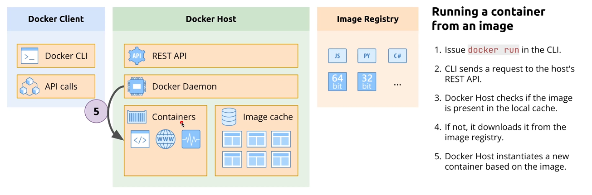

# Docker Components
In this section, we will see different components of Docker and how they work.

## Docker Client
Docker client is a **command line tool** that allows you to interact with docker daemon. It has two parts:
1. Docker CLI: Command line interface that allows you to run docker commands.
2. Docker API: API that allows you to interact with docker daemon or docker host.
---
## Docker Host
Docker host is a machine on which the Docker daemon runs. It can be a physical machine or a virtual machine. The Docker host is responsible for managing all Docker resources and orchestrating how they interact.

### Request Flow & Components

**1. REST API**
The entry point that receives requests from the Docker client. It acts as the gateway between the client commands and the Docker daemon's processing engine.

**2. Docker Daemon**
The core service that processes all requests coming through the REST API. It acts as the orchestrator, managing all other components and coordinating their interactions.

**3. Images**
Read-only templates that serve as blueprints for creating containers. The Docker daemon uses the local image cache (pulled from a registry or built locally) to quickly spawn new containers without needing to download them repeatedly.

**4. Containers**
Living instances spun up from images by the Docker daemon. Each container gets its own isolated process space with dedicated CPU and memory limits, managed by the daemon to ensure resource efficiency and system stability.

**5. Networks**
Virtual networking infrastructure managed by the daemon that enables containers to communicate with each other, the host machine, and external systems. Supports multiple network types (Bridge, Host, Overlay) for different communication patterns.

**6. Volumes**
Persistent storage managed by the daemon for data that must survive container termination. The daemon handles the actual storage in dedicated directories (typically `/var/lib/docker/volumes`) and mounts them into containers as needed.

---
## Image Registry
Image registry is a server that stores and distributes docker images. It can be a private registry or a public registry. Example of public registry is Docker Hub and example of private registry is Google Container Registry.

**Steps to push an image to registry**:
1. **Login to registry**
   Authenticate with your Docker registry (e.g., Docker Hub).
   ```bash
   docker login
   ```
   *Provide your username and password when prompted.*

2. **Tag image**
   Tag your local image with your registry username and repository name.
   ```bash
   # Syntax: docker tag <local_image> <registry_username>/<repository_name>:<tag>
   docker tag my-app madhubabukencha/my-app:v1
   ```

3. **Push image**
   Upload the tagged image to the registry.
   ```bash
   # Syntax: docker push <registry_username>/<repository_name>:<tag>
   docker push madhubabukencha/my-app:v1
   ```

---
