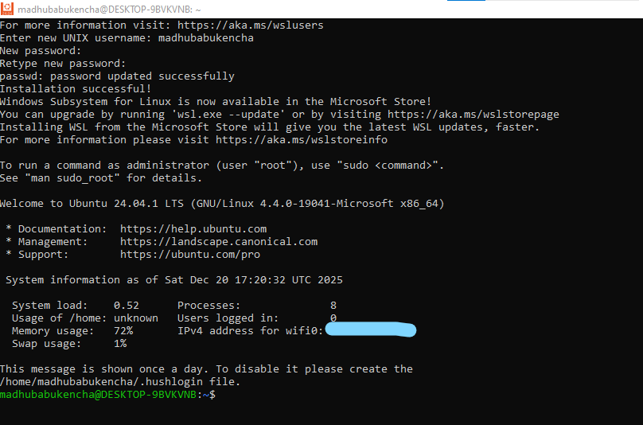

# Docker Installation on Windows
In this section, we will install Docker on Windows.

## Setup Windows Subsystem for Linux (WSL)
### Why Do We Need WSL?

Docker containers are lightweight Linux environments. Since Windows uses a different kernel than Linux, Docker cannot run directly on Windows hardware the same way it does on Linux.

**Windows Subsystem for Linux (WSL)** is a compatibility layer that allows Windows to run a Linux kernel alongside the Windows OS. Docker uses this Linux kernel (specifically WSL 2) to run containers efficiently and natively, providing better performance than older virtualization methods.

### How to Set Up WSL

1. Open the Microsoft Store and search for "Windows Subsystem for Linux".
2. Select the version of Linux you want to install (e.g., Ubuntu 24.04.1 LTS).
3. Open the downloaded app and follow the on-screen instructions to complete the installation.
4. If you encounter any WSL issues, you may need to enable WSL in Windows Features. [See the Appendix](#enable-wsl-in-windows-features) for steps.

A successful installation will look like this:

   

5. To check details about your installed Ubuntu system:
   ```bash
   cat /etc/os-release
   ```

6. To access Ubuntu directly from Windows Terminal, open your terminal and type:
   ```bash
   wsl
   ```
---
## Docker Installation

1. Check the official [Docker Installation guide for Windows](https://docs.docker.com/desktop/setup/install/windows-install/).
2. Download the suitable executable file for your Windows version.
3. Run the downloaded file and follow the on-screen instructions.
4. Verify the installation by opening your terminal and running:
   ```bash
   docker --version
   ```
---
## Appendix
### Enable WSL in Windows Features

#### Method 1: Using PowerShell (Admin)

1. Right-click the Start button and select **Windows PowerShell (Admin)** or **Terminal (Admin)**.
2. Paste the following command and press Enter:
   ```powershell
   dism.exe /online /enable-feature /featurename:Microsoft-Windows-Subsystem-Linux /all /norestart
   ```
3. Restart your computer when prompted.

#### Method 2: Using Settings

1. Type "Turn Windows features on or off" in your search panel.
2. Check the box next to "Windows Subsystem for Linux".
3. Click OK and restart your computer when prompted.

### Convert WSL 1 to WSL 2

If you have WSL 1 installed and try to access Docker, you might see the following message:
```
$ docker

The command 'docker' could not be found in this WSL 1 distro.
We recommend to convert this distro to WSL 2 and activate
the WSL integration in Docker Desktop settings.

For details about using Docker Desktop with WSL 2, visit:

https://docs.docker.com/go/wsl2/

```

To convert from WSL 1 to WSL 2, run the following commands in PowerShell with admin privileges:

```bash
PS C:\Windows\system32> wsl -l -v
  NAME              STATE           VERSION
* Ubuntu-24.04      Running         1
  docker-desktop    Running         2

PS C:\Windows\system32> wsl --set-version Ubuntu-24.04 2
For information on key differences with WSL 2 please visit https://aka.ms/wsl2
Conversion in progress, this may take a few minutes.
The operation completed successfully.

PS C:\Windows\system32> wsl -l -v
  NAME              STATE           VERSION
* Ubuntu-24.04      Running         2
  docker-desktop    Running         2
PS C:\Windows\system32> wsl
To run a command as administrator (user "root"), use "sudo <command>".
See "man sudo_root" for details.

PS C:\Windows\system32>$ docker
Usage:  docker [OPTIONS] COMMAND

A self-sufficient runtime for containers
```